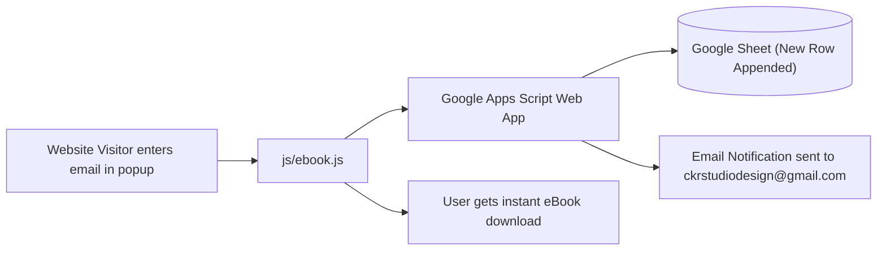

# EOH Google Sheets & Email Notification Setup

This system automatically:
1. **Stores every subscriber email** entered in the Free eBook popup (and footer newsletter) directly into your private Google Sheet.
2. **Auto-creates formatted columns** with dates, emails, and campaign details.
3. **Instantly emails an alert** to `ckrstudiodesign@gmail.com` with one-click access to the Google Sheet.

---

## 2-Minute Setup Guide

### Step 1: Create a new Google Sheet
1. Open [Google Sheets](https://sheets.new) in your web browser.
2. Name the spreadsheet: **`EOH Leads & Subscribers`** (at the top left).

---

### Step 2: Open the Apps Script Editor
1. In the top Google Sheets menu, click **Extensions** → **Apps Script**.
2. A new tab will open with a code editor showing a file named `Code.gs`.

---

### Step 3: Paste the Code
1. Erase any default code in `Code.gs`.
2. Open the file [`google-apps-script.js`](./google-apps-script.js) from this repository, copy its entire contents, and paste it into `Code.gs`.
3. Press **Ctrl + S** (or click the disk icon) to save.

---

### Step 4: Deploy as a Web App
1. In the top right corner of the Apps Script page, click **Deploy** → **New deployment**.
2. Click the gear icon next to "Select type" and choose **Web app**.
3. Fill in the fields:
   - **Description**: `EOH Leads API`
   - **Execute as**: `Me (your email)`
   - **Who has access**: **`Anyone`** *(⚠️ Critical: must be "Anyone" so website visitors can submit without needing a Google login)*
4. Click **Deploy**.

---

### Step 5: Authorize Permissions (One-Time)
1. Click **Authorize access**.
2. Choose your Google account (`ckrstudiodesign@gmail.com`).
3. Google will show an *"Advanced / Google hasn't verified this app"* screen:
   - Click **Advanced** (small text on the bottom left).
   - Click **Go to EOH Leads API (unsafe)**.
   - Click **Allow**.

---

### Step 6: Copy the Web App URL & Add to Website
1. Copy the generated **Web app URL** (it looks like: `https://script.google.com/macros/s/AKfycb.../exec`).
2. Open [`js/ebook.js`](./js/ebook.js) in your website code.
3. In `CONFIG`, paste your URL into `sheetScriptUrl`:
   ```javascript
   var CONFIG = {
     sheetScriptUrl: 'https://script.google.com/macros/s/AKfycb.../exec',
     notificationEmail: 'ckrstudiodesign@gmail.com',
     ...
   };
   ```
4. Save and push to your repository.

---

## How It Works



- When a visitor enters their email in the eBook modal and clicks **Send me the eBook**, their email is transmitted via encrypted HTTPS to your Google Apps Script.
- The script locks the row, timestamps the entry (Dubai GMT+4 / local time), formats the table if new, and sends a notification email to **ckrstudiodesign@gmail.com**.
- The visitor is immediately granted access to download the eBook.
